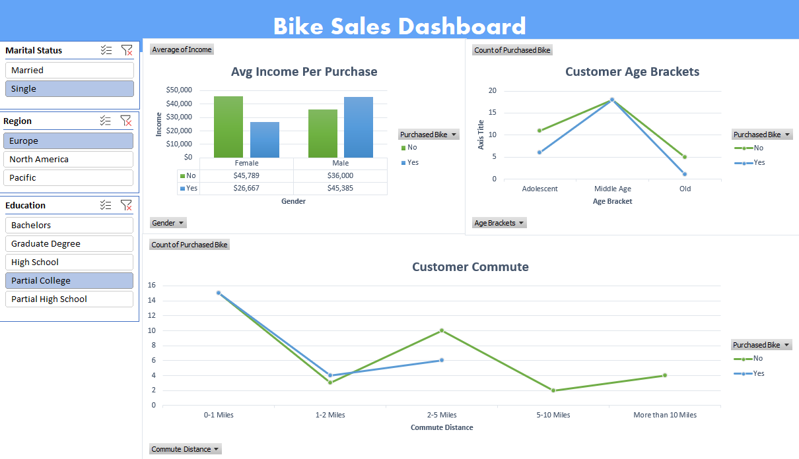

# Bike-Sales-Dashboard-Excel
This project focuses on analyzing bike sales data using Microsoft Excel.

The goal was to explore customer demographics and purchasing behavior through an interactive dashboard.

## Tools & Skills
- Microsoft Excel
- Pivot Tables
- Pivot Charts
- Slicers and Filters
- Data Analysis
- Dashboard Creation

## Dashboard Features
- Average income by gender and purchase status.
- Customer age group analysis.
- Customer commute distance analysis.
- Interactive filters by marital status, region and education.

## Project Preview

## Objective
To practice data organization, analysis and visualization using Microsoft Excel.

Data sets from https://github.com/AlexTheAnalyst/Excel-Tutorial/blob/main/Excel%20Project%20Dataset.xlsx
